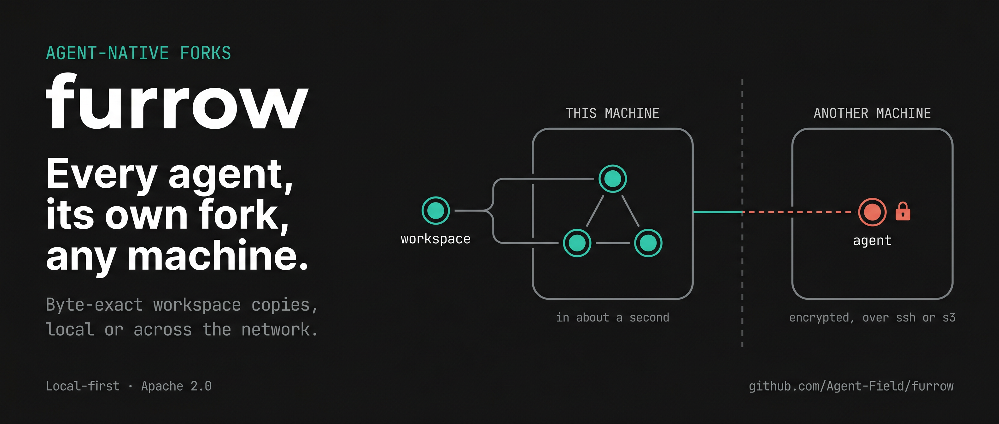

<div align="center">

# furrow

### Every agent, its own fork, any machine

[](LICENSE)
[](https://github.com/Agent-Field)

<p>
  <a href="#parallel-agents-one-machine">Parallel Agents</a> •
  <a href="#parallel-agents-another-machine">Distributed Agents</a> •
  <a href="#rewind-what-git-cant-see">Rewind</a> •
  <a href="#the-rest-of-the-daily-kit">Daily Kit</a> •
  <a href="#how-its-built">Architecture</a>
</p>



</div>

**furrow snapshots your working directory, including ignored files, dependencies, and local state, and creates isolated forks locally or materializes snapshots on another machine.** Local forks use filesystem copy-on-write when available, with a streaming-copy fallback. Capture policy, filesystem support, and the fidelity report determine what can be restored.

Local forks can share unchanged disk blocks on supported filesystems; sealed, encrypted objects carry captured state to another machine. This includes local files that would otherwise need to be copied and configured by hand before an agent can start.

```bash
cd my-project && furrow watch
```

That's the whole setup. From this moment your workspace is continuously sealed into an immutable, content-addressed timeline: fork it, diff it, merge it, materialize it on another machine, rewind it when anything — human or agent — breaks it. Git versions your commits; furrow versions everything between them.

Local-first and Apache-2.0. No account, no telemetry, works offline. Snapshot content is encrypted before it reaches a remote.

Every scenario below is a runnable script in [`./demo/`](demo/).

---

## Parallel agents, one machine

Start your agents the way you always start them — just more of them. One optional alias gives every session its own universe automatically:

```bash
alias claude='furrow exec -- claude'    # once, in your shell profile
```

Now open three terminals and run `claude` in each. Each session gets an isolated copy of captured working state, including dependencies, `.env`, and database files unless excluded by policy. Filesystem copy-on-write can share unchanged disk blocks; the fallback copies files. Applications still need their own port configuration.

While they work, **conflict radar** watches all universes and flags two agents touching the same file *before* merge time. Agents can partition work and leave notes for each other through plain files — no orchestrator. When a universe is done:

```bash
furrow merge <universe> --check "cargo test --all"    # lands only if your checks pass
```

Skip the alias and sessions simply share the directory like today — still sealed continuously, still collision-warned. `furrow forks` shows every universe, its real disk cost, and live conflicts whenever you're curious.

## Parallel agents, another machine

Same fork, different machine. Cloud sandboxes and second machines normally see your last push — never your dirty edits, `.env`, dev database, or Git index. furrow can materialize captured state on another machine over SSH (including LAN or Tailscale), or through an S3-compatible bucket as an encrypted mailbox. Capture policy and the destination filesystem determine which files and metadata can be restored. No hosted service is required.

```bash
furrow remote add ssh://dev@machine-a.example.test --name my-project && furrow sync --follow

# on the other machine — the clone is your complete working state, not a checkout
FURROW_RECOVERY_KEY=<key> furrow clone ssh://dev@machine-a.example.test/my-project
```

`sync --follow` keeps a session that reconciles sealed changes in either direction. Only missing objects transfer, so a small edit can send a small delta. Remotes hold ciphertext; a machine needs the recovery key to read it.

> A laptop died mid-session. The exact working directory — dirty edits, `.env`, dev database — came back on a different machine from an S3 bucket that never saw plaintext.

**Historical upstream measurements:** Agent A edits source and tests on one machine, furrow
encrypts and publishes the sealed state, and Agent B receives a usable workspace
on a separate machine, reviews it, and sends a follow-up change back.

| Two-agent workflow | End-to-end rate |
|---|---:|
| Optimized warm handoff gate between two running workspaces | **4.1 handoffs/s** |
| Actual furrow repo, cold publish over the internet | **0.27 MB/s** |
| Actual furrow repo, cold materialization on machine B | **0.40 MB/s** |
| Raw `scp` of the same uncompressed repo payload | **0.71 MB/s** |

The real-repo run covered 67 files / 1.14 MB plus two source-and-test agent
turns. Rates include encryption and transport; handoff and materialization also
include making the destination usable. Idle RSS was 16.6 MB on machine A and
15.7 MB on machine B for its follower plus A's remote helper. The encrypted
remote occupied 12.9 MB after the cold state and retained agent turns. These are
observed integration results, not guarantees, and have not been remeasured for
v0.2.0.

## Rewind what Git can't see

An agent just ran `git clean -fdx`, trashed `.env`, and corrupted the dev database. Git protects none of that; furrow's timeline holds all of it — and every rewind seals the current state first, so rewinding is itself rewindable.

```bash
furrow timeline                          # scrub your history — turns, labels, quiet points
furrow rewind <snapshot> --paths .env    # one secret back, newer work untouched
furrow rewind <snapshot>                 # or the whole workspace, byte-exact
```

Restoration covers symlinks, permissions, supported user extended attributes, hard links, SQLite (with a logically consistent image available), and Git's own mutable state. macOS system-managed attributes are omitted. On filesystems that fold case or Unicode names, rewind holds colliding names out of its plan and reports them in `held`; the snapshot retains both entries. `--dry-run` previews a rewind's impact first.

> `.env` and the dev SQLite database, both back, both intact, after an agent ran `git clean -fdx`.

## The rest of the daily kit

- **`furrow try -- npm install framework@latest`** — run anything risky with automatic before/after restore points. Keep the result or be back in seconds.
- **`furrow bisect -- cargo test`** — "it worked twenty minutes ago" usually has no commit to bisect. This bisects *states*, in disposable CoW forks, and finds the breaking moment even when the culprit was an `.env` edit or a dependency change Git never saw.
- **`furrow shrink`** — reclaims recognized dependency/build caches with honest numbers; everything removed stays exactly restorable.
- **`furrow ui`** — Mission Control: timeline scrubbing, universes, live radar, diffs, and merge preview in a local page embedded in the binary. No Node, no CDN, no account.

## Built for agents as first-class users

The CLI is the agent API: `--json` provides command results with stable snapshot IDs, while long-running commands use text or protocol streams. Rewind exposes `--dry-run` and `--yes` for scripted use. `furrow hook install` writes adapters for attributed restore points; `furrow events --follow` streams seals, conflicts, and merges as resumable NDJSON; `furrow mcp` serves harnesses that prefer MCP. Claude Code, Codex, Cursor, and shell scripts can use the same commands.

<details>
<summary><strong>Full command reference</strong> — every command, one line each</summary>

| Command | What it does |
|---|---|
| `furrow watch` | Attach a repo and start continuous sealing |
| `furrow exec -- <cmd>` | Run a command inside its own isolated universe |
| `furrow merge <universe> --check "<cmd>"` | Land a universe's changes, only if checks pass |
| `furrow forks` | List universes, disk cost, live conflicts |
| `furrow timeline` | Scrub sealed history |
| `furrow rewind <snapshot> [--paths] [--dry-run]` | Restore workspace state, whole or partial |
| `furrow try -- <cmd>` | Run something risky with automatic before/after restore points |
| `furrow bisect -- <cmd>` | Bisect workspace state, not just commits |
| `furrow shrink` | Reclaim recognized dependency/build caches |
| `furrow ui` | Mission Control — local web UI, no account |
| `furrow remote add <url>` | Add a remote (SSH or S3-compatible) |
| `furrow sync --follow` | Keep a warm two-way sync session with a remote |
| `furrow clone <url>` | Materialize a workspace's exact state on another machine |
| `furrow hook install` | Turn agent turns into attributed restore points |
| `furrow events --follow` | Stream seals/conflicts/merges as NDJSON |
| `furrow mcp` | Serve furrow over MCP for harnesses that prefer it |
| `furrow exchange export\|published\|want\|import` | Exchange sealed object frames and track publication ledgers |
| `furrow exchange rebind\|materialize` | Follow a moved workspace or restore an imported head |
| `furrow serve --socket <path>` | Serve engine requests over a local Unix socket |

</details>

## How it's built

The load-bearing decisions, for readers who want them:

- **Immutable Merkle DAG over content-defined chunks.** A snapshot is published only after its referenced bytes are durable. Changed-path sealing visits supplied paths and their ancestors; full capture walks the tree and reuses a stat cache. New hard links or policy changes can require a full walk.
- **Crash-safe by construction.** Hash-verified append-only packs, an fsynced hash-chained publication log, recovery from truncated pack tails and deleted indexes — SQLite is an advisory index, never the truth.
- **Warm forks via native CoW** — APFS `clonefile`, Linux `FICLONE` — with a streaming-copy fallback whose cost is disclosed before the fork runs.
- **Retention with honest grades.** Timelines thin under hard disk budgets; every snapshot knows whether it's byte-exact or partial, and every missing path knows its recovery route. Pins override everything. `furrow estimate` projects store cost before you ever attach.
- **Encryption below the transport.** XChaCha20-Poly1305, opaque remote names, every chunk verified against its BLAKE3 identity on restore; path traversal and symlink-escape tricks rejected at the boundary.
- **An external store by default.** Ordinary workspaces keep identity pointers in `.furrow/`; deleting them is recoverable from the store. Composed workspaces keep identity entirely in the store. Exclusions (`.furrowpolicy`: `exclude node_modules`) are honored by capture, watcher, and rewind alike.

Reproducible performance harness — `cargo bench -p furrow-core --bench engine` (regression ceilings and a 1M-file reference profile are available). Methodology and historical baselines: [docs/performance.md](docs/performance.md).

## Honest edges

- Cross-machine divergence is preserved and reported, not yet auto-merged — smoothest today: one writer at a time, hand off after convergence.
- Same-path universes are Linux; macOS uses disclosed sibling directories.
- Cold internet sync has been rerun; the final receiver optimization still needs a warm internet rerun.
- Fidelity is declared, not implied: `furrow status --fidelity` is the contract.

## Development

The Cargo workspace contains three crates:

- [`furrow-core/`](furrow-core/): the engine library, imported as `furrow`, with embedded UI assets in `furrow-core/ui/` and benchmarks in `furrow-core/benches/`.
- [`furrow-cli/`](furrow-cli/): the `furrow` binary and CLI integration tests.
- [`furrow-daemon/`](furrow-daemon/): persistent repositories and request handling for `furrow serve`.

Use the Rust toolchain pinned in `rust-toolchain.toml`. From the repository root:

```bash
cargo build --release --locked -j 2
./target/release/furrow --version
cargo test --locked -j 2 --no-fail-fast
cargo fmt --check
# Optional, if Clippy is installed for the pinned toolchain:
cargo clippy --locked --all-targets --all-features -j 2 -- -D warnings
# Install the CLI from this checkout:
cargo install --locked --path furrow-cli -j 2
```

Build output lives in the ignored root `target/` directory. Release tags build
`furrow-cli` for Linux, macOS and Windows on amd64 and arm64. Assets are named
`furrow-linux-amd64`, `furrow-linux-arm64`, `furrow-darwin-amd64`,
`furrow-darwin-arm64`, `furrow-windows-amd64.exe`, and `furrow-windows-arm64.exe`.
`SHA256SUMS` covers every asset.

Native Windows requires Windows 10 1803 or newer for the daemon's AF_UNIX
socket. `serve --socket <path>` uses the same newline-delimited JSON protocol
as Unix, exits when idle, and drains requests on Ctrl-C, Ctrl-Break or console
close. Keep the socket path short (the AF_UNIX limit is 108 bytes).
Snapshots store `/` paths and untouched bytes; Windows preserves a recorded
POSIX mode when sealing again and gives new files mode 0644. Names Windows
refuses, case collisions, FIFOs, and symlinks without permission are left out
of restoration and reported with reasons in JSON `held`. The snapshot retains
those entries. Long workspace paths use Windows verbatim absolute paths.
File replacement retries sharing violations for at most 1.27 seconds before
reporting a blocked-file error. File durability uses FlushFileBuffers;
directory syncing is a no-op on Windows. POSIX extended attributes and native
CoW are unavailable there; forks use independent streaming copies. Restore previews
ignore Windows directory timestamp differences and compare their children
recursively: NTFS directory listings can report a stale last-write time.

Engine integrations can use `furrow exchange <verb> --help` and
`furrow serve --help` to discover their runtime contract. Exchange encryption
reads `FURROW_CELL_KEY` and `FURROW_DEDUP_SECRET` from the environment; export
writes frames for the caller to transport. Hook sealing accepts repeatable
`--changed PATH`, NUL-separated `--changed-stdin`, and `--cell-dir DIR` for an
external directory composed as `.cell/`, replacing any root `.cell/` entry in
the sealed tree. An explicitly empty changed list
means nothing changed; omitting the list requests a full capture.

Windows MSVC executables reserve 32 MiB of stack through `.cargo/config.toml`,
for debug and release builds, including daemon and test helpers. The same
configuration statically links the MSVC runtime so fresh machines need no runtime
installer. Debug command parsing alone can use more than Windows' default 1 MiB stack; recursive capture
also needs headroom. The reserve uses virtual address space and commits pages on
use. Keep this workspace configuration when building Windows artifacts.


Relocated Windows tests use a debug companion built with
`--features furrow-core/fault-injection`, matching Cargo's test dependencies.
Crash tests arm these points through their own environment; ordinary release
builds compile them out.

The CLI, daemon and exchange behavioural suites run on native Windows as well as
Unix. Tests scope POSIX mode changes, executable hook scripts, privileged symlink
creation and macOS attributes to the platforms that support them. Windows warm
materialization checks use NTFS file IDs to detect unintended rewrites.

The black-box suite runs against independent temporary Git repositories and isolated stores: secret recovery, reversible rewind, metadata fidelity, SQLite logical recovery, index reconstruction, truncated-pack recovery, path-escape rejection, interrupted-rewind recovery, and fork isolation.

## License

Apache-2.0
